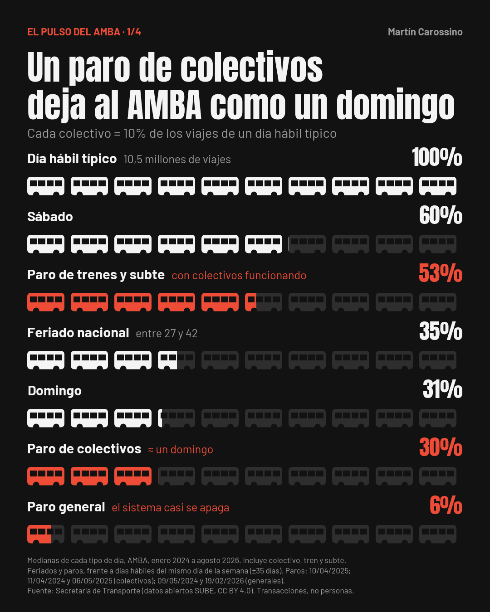
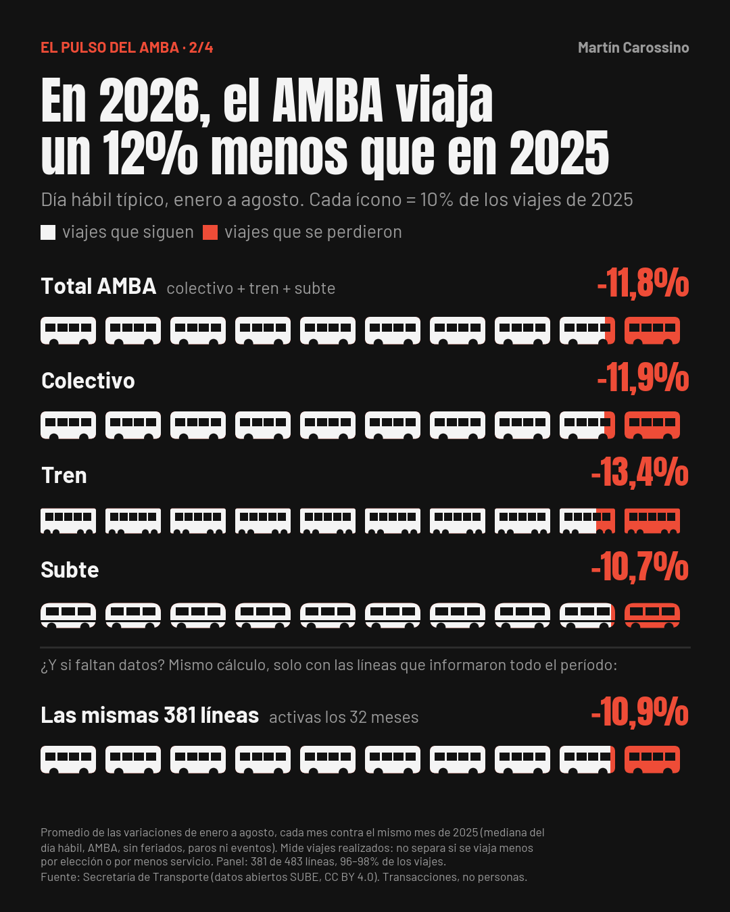
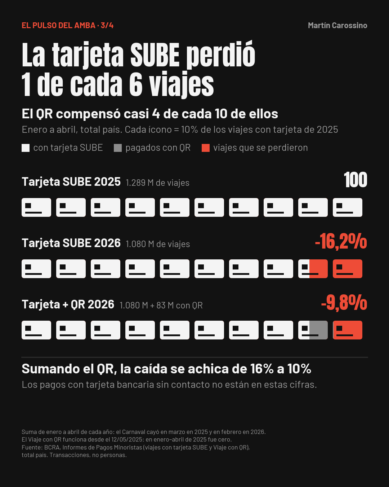
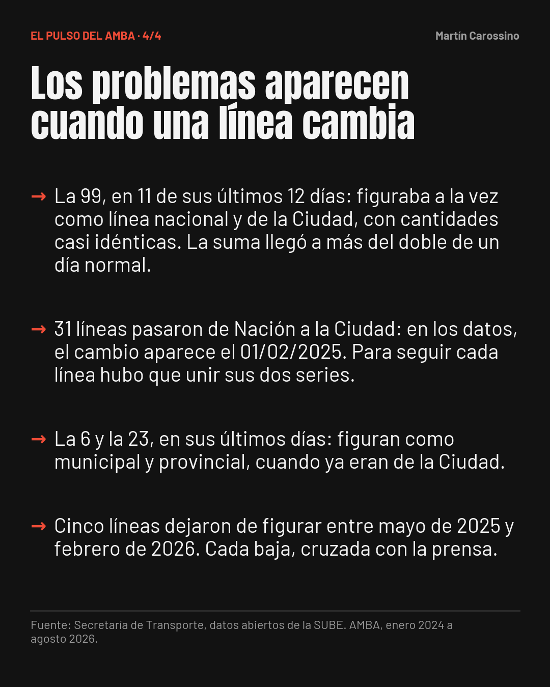

# El pulso del AMBA

Análisis de 1,5 millones de registros de los datos abiertos de la SUBE (enero de 2024 a agosto de 2026), con SQL en DuckDB y Python. Cada cifra publicada se recalcula y se controla en el propio notebook antes de mostrarse.

[](https://colab.research.google.com/github/MartinCarossino/pulso-amba-sube/blob/main/pulso_amba.ipynb)

## Hallazgos

**1. Un paro de colectivos deja al AMBA como un domingo.** Si un día hábil típico (10,5 millones de viajes) vale 100, un paro de colectivos deja 30 y un domingo, 31. Más de 8 de cada 10 viajes de un día hábil van en colectivo.



**2. De enero a agosto de 2026, el AMBA viajó un 12% menos que en 2025.** Caen los tres modos: colectivo −11,9%, tren −13,4% y subte −10,7%. Los ocho meses están por debajo de 2025. Contando solo las 381 líneas con viajes todos los meses, que suman el 96–98% del total, la caída es del 10,9%: no es un faltante de datos.



**3. De enero a abril de 2026, la tarjeta SUBE perdió 1 de cada 6 viajes; el QR compensó casi 4 de cada 10.** Según el Banco Central (enero a abril, todo el país), la tarjeta pasó de 1.289 a 1.080 millones de viajes (−16%). Los 83 millones de viajes con QR de 2026 equivalen a casi 4 de cada 10 de los 209 millones que perdió la tarjeta. Sumando tarjeta y QR, la caída es del 10%.



**4. Los problemas que encontré en la fuente aparecen cuando una línea cambia.** La línea 99 figuró en dos jurisdicciones a la vez en 11 de sus últimos 12 días: 123.437 viajes contados dos veces. El traspaso de 31 líneas de Nación a la Ciudad, las jurisdicciones mal asignadas de las líneas 6 y 23 y cinco bajas de líneas se documentan y se resuelven en el modelo de datos.



El carrusel completo: [1](imagenes/post4_slide_1.png) · [2](imagenes/post4_slide_2.png) · [3](imagenes/post4_slide_3.png) · [4](imagenes/post4_slide_4.png).

## Cómo se verificó

- **17 controles automáticos** sobre el modelo de datos: nada se pierde ni se altera entre el CSV oficial y las tablas de DuckDB.
- **Una fuente independiente:** de enero a octubre de 2025, los datos abiertos quedan entre un 2% y un 8% por debajo de los viajes con tarjeta SUBE que informa el Banco Central, en todo el país.
- **El calendario:** los 44 feriados que cayeron en día hábil muestran caída, sin excepción.
- **Sensibilidad:** sin los 7 días hábiles que caen sin causa confirmada, la caída de 2026 se mueve como mucho 0,2 puntos.
- **66 controles finales:** cada cifra publicada se recalcula y se compara con su valor publicado. Si alguna no coincide, el notebook la marca como REVISAR.

Qué se verificó, cómo y con qué resultado: [`docs/bitacora_verificacion.md`](docs/bitacora_verificacion.md). Cada cifra con su origen: [`docs/cifras_publicadas.md`](docs/cifras_publicadas.md).

## Cómo reproducirlo

1. Abrir `pulso_amba.ipynb` en Google Colab (botón de arriba).
2. *Entorno de ejecución → Ejecutar todo.* El notebook descarga los CSV oficiales y el calendario de feriados, y toma `datos_bcra.csv` de este repositorio.
3. Verificar los resultados esperados: sección 05, 17 de 17; sección 12, 66 de 66.

Las cifras se congelaron con la descarga del 16/10/2026 (1.517.680 filas; período consolidado hasta el 31/08/2026). Una descarga posterior trae más días preliminares, posteriores al corte, que no cambian las cifras. Versiones usadas: Python 3.13, pandas 2.2.3, DuckDB 1.3.2, Matplotlib 3.10.0.

## Estructura

```
pulso_amba.ipynb        notebook completo, con salidas (secciones 00 a 12)
datos_bcra.csv          serie del Banco Central cargada a mano, con el informe de origen de cada cifra
docs/                   bitácora de verificación y cifras publicadas
imagenes/               gráficos de la serie y carrusel de verificación
```

## Alcance

- AMBA según la SUBE (`amba = 'SI'`), de enero de 2024 a agosto de 2026.
- Se cuentan transacciones, no personas: quien combina colectivo y tren cuenta dos veces.
- La SUBE mide cuánto se viaja, no por qué: no separa una caída de la demanda de una menor oferta de servicio.
- El Banco Central informa tarjeta SUBE y QR. Los pagos con tarjeta bancaria sin contacto no forman parte de esa serie.

## Fuentes y licencia

- Secretaría de Transporte de la Nación: [SUBE - Cantidad de transacciones (usos) por fecha](https://datos.transporte.gob.ar/dataset/sube-cantidad-de-transacciones-usos-por-fecha), licencia CC BY 4.0.
- Banco Central de la República Argentina: Informes Mensuales de Pagos Minoristas.
- Feriados: API de ArgentinaDatos (`api.argentinadatos.com/v1/feriados`), verificada contra la caída de viajes de cada feriado.
- Paros y fusiones de líneas: notas de prensa citadas en la bitácora.

Código bajo licencia MIT. Los datos pertenecen a sus fuentes.

**Martín Carossino** · [LinkedIn](https://www.linkedin.com/in/martincarossino) · [Portfolio](https://martincarossino.github.io)
